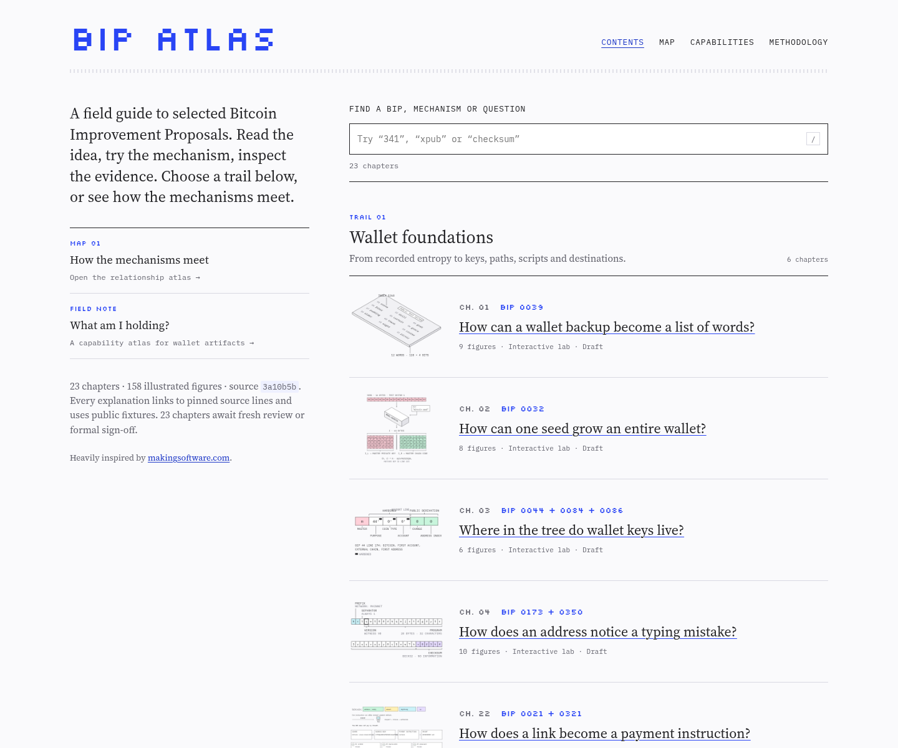

# BIP Atlas

An illustrated, evidence-checked field guide to selected Bitcoin Improvement Proposals. Read the idea, try the mechanism, inspect the evidence.

**[Open the live site](https://bip-atlas.pages.dev)** · [Relationship map](https://bip-atlas.pages.dev/map/) · [Capability atlas](https://bip-atlas.pages.dev/capabilities/) · [Methodology](https://bip-atlas.pages.dev/methodology/)



BIP Atlas is heavily inspired by [makingsoftware.com](https://makingsoftware.com). It uses static Astro pages, local Preact interactive islands, self-hosted fonts, and no analytics or third-party runtime services.

## Current status

- Twenty-three hand-authored chapters are implemented on `feat/atlas-experience`, with 158 illustrated figures. The five expansion chapters cover PSBTv2/Taproot/MuSig2 records (BIPs 370/371/373), Compact Block Relay (152), opt-in full-RBF (125), payment instructions (21/321), and addrv2 (155).
- Every chapter currently remains a draft awaiting fresh technical review or formal sign-off. Independent technical review and automated checks do not constitute human approval.
- `noindex` stays enabled until human sign-off. Passing tests and building the site do not constitute technical approval.
- The models are teaching models, not wallets, production signers or full protocol-conformance suites.

See [HANDOFF.md](HANDOFF.md) for the current engineering and review state. The site’s [methodology page](https://bip-atlas.pages.dev/methodology/) describes published vectors, additional checks and model limits chapter by chapter.

## Explore the project

- **Five trails** organize the 23 chapters by wallet foundations, transactions, signatures, privacy, and network upgrades. Cover search accepts BIP numbers, mechanism names, aliases and questions.
- **The relationship map** connects chapters through explicit mechanism dependencies and comparisons, with a complete HTML relationship ledger.
- **“What am I holding?”** compares wallet artifacts by purpose, capability boundary, sharing consequence, and links into the evidence-bearing chapters.
- **Mobile chapter layouts** put the opening figure before the long introduction and retain a disclosure TOC. Taproot uses a focused proof path on small screens.
- **Exact figure URLs** round-trip the address checksum lab’s sample, position and edited character, and Taproot’s spending path, leaf and proof view. Eligible address fixtures link directly into the lab.
- **Expansion figures** give each new chapter a distinct mechanism drawing. Labs pre-render every scenario and stage, use native selects for long example lists, and preserve a static reading path without JavaScript. MuSig2 shows participant keys, public nonces and partial signatures as a three-stage static sequence.

The trails, map and capability atlas render without JavaScript. Cover search and interactive figures use JavaScript only where it adds behavior. The expansion adds no new Preact island or runtime dependency.

## Develop

Requirements: Node.js 20+, pnpm 9, and Python 3.10+ for the complete test suite. Git is also needed for source-snapshot tooling.

```sh
pnpm install
pnpm dev
```

The development server runs on port 4321.

```sh
pnpm check       # TypeScript checks
pnpm test        # Vitest plus the Python starter/vector suite
pnpm build       # Static production build
pnpm preview     # Serve the build on port 4322
```

CI runs the same install, typecheck, test and build sequence on pushes to `main`, pull requests, and manual runs. It deploys when the Cloudflare secrets are present: `main` to production, other refs to preview URLs.

For an explicit non-production branch deployment using the repository’s pinned Wrangler:

```sh
pnpm build
pnpm exec wrangler pages deploy apps/site/dist --project-name bip-atlas --branch=feat/atlas-experience
```

The branch flag keeps the `main` production deployment separate. Do not use a force deploy or change review states as part of deployment.

## Repository map

- `apps/site/`: Astro routes, layouts, components, content loaders and styles.
- `content/chapters/`: typed, question-led chapter publications.
- `content/evidence/`: claim ledgers with exact source spans and quotations.
- `content/atlas.json`: validated trails, map nodes and chapter relationships.
- `content/capabilities.json`: artifact capability boundaries and source-section links.
- `fixtures/`: published inputs and explicitly labelled synthetic teaching cases, with source-errata metadata where needed.
- `packages/publication/`: publication and atlas contracts plus content tests.
- `packages/models/`: deterministic teaching models, including the five expansion protocol models and their published-vector and boundary tests.
- `packages/figures/`: illustration kit, chapter-specific mechanism motifs, pre-rendered lab states, and figure-view URL support.
- `sources/`: pinned upstream files, hashes and source locks.
- `review/`: editorial, technical, visual and accessibility review records.
- `tools/`: screenshot, accessibility/tablet audit and vector-extraction scripts, including the stage-preserving expansion extractor.

## Evidence and safety

Chapters cite an exact `bitcoin/bips` revision. Validation checks claim references, verbatim source quotations, source commits, fixture provenance, external-vector hashes, figure recipes, and atlas/chapter links. PSBT fixtures also check hex against adjacent Base64; documented source typos and duplicates are recorded rather than hidden.

Only public test vectors and explicitly marked synthetic fixtures belong in the project. The site does not accept real recovery phrases, private keys, arbitrary addresses, messages to sign, or PSBT uploads. It does not sign or broadcast transactions. Valid encodings do not establish ownership, balance, recipient safety or current consensus policy.

BIP 321 supersedes BIP 21 in the payment-instructions chapter. Proof-of-payment callbacks are constructed locally, with only the published placeholder application schemes supported; browser and unknown schemes are refused. Nothing opens an application, sends a payment, contacts a peer or requests an external callback.

Raw upstream source files retain their own licenses and notices. Do not replace those notices when refreshing snapshots.

## Change or review content

1. Read the chapter and its evidence ledger, not just the rendered page.
2. Preserve source-line accuracy, fixture provenance, scope limits and the typed publication contract.
3. Keep trails, map relationships and capability source links synchronized with chapter additions or section renames.
4. Run `pnpm check`, `pnpm test`, and `pnpm build`.
5. Inspect the actual production page at desktop, tablet and phone widths, including no-JavaScript reading and keyboard interaction.
6. Leave review-state changes to the human review process. Do not treat editorial revisions, automated checks or screenshots as approval.

The optional browser-audit tooling and its setup are documented in [HANDOFF.md](HANDOFF.md). Automated accessibility checks are not a substitute for a real screen-reader session.

## Original implementation kit

The original specification and starter artifacts remain in the repository, including `BIP_ATLAS_SPEC.md`, `catalog.json`, `catalog-phase3.json`, `design-tokens.css`, `prompts/`, `scripts/`, and the Python starter tests. They are design and research inputs, not the current application quick start. Expansion briefs live separately in `catalog-expansion.json`. [HANDOFF.md](HANDOFF.md) is the authoritative starting point for current implementation work.
